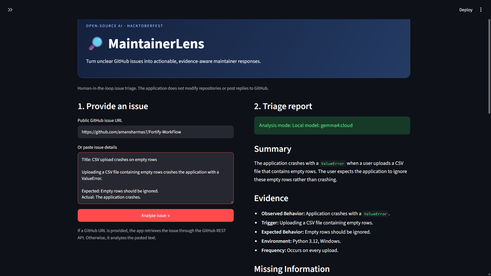
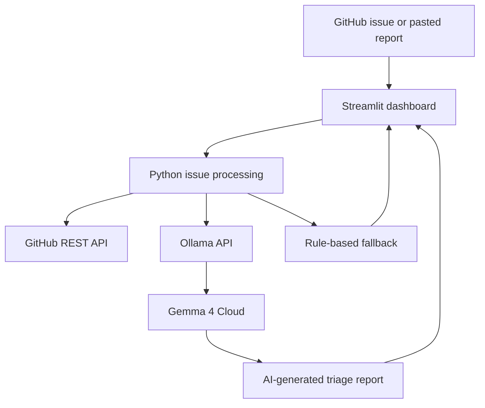

# MaintainerLens

AI-assisted GitHub issue triage for open-source maintainers.

## Problem

Open-source maintainers spend time investigating incomplete bug reports that lack reproduction steps, error logs, environment details, or expected behavior.

## Solution

MaintainerLens analyzes public GitHub issues or pasted reports, identifies missing diagnostic information, suggests triage priorities, and drafts maintainer replies.

## Features

- Retrieve public GitHub issues through the GitHub REST API.
- Analyze pasted issue descriptions.
- Identify potentially missing diagnostic information.
- Generate triage reports and maintainer reply drafts.
- Integrate Gemma 4 Cloud through Ollama.
- Offer a clearly labelled rule-based fallback if AI inference fails.
- Download reports as Markdown.
- Keep maintainers in control: no automatic GitHub replies or repository modifications.

## Technology stack

- Python
- Streamlit
- GitHub REST API
- Ollama
- Gemma 4 Cloud

## Requirements

- Python 3.11+
- Ollama installed and signed in for cloud inference
- Internet access for GitHub and cloud model requests

## Run locally

Create a virtual environment:

```powershell
python -m venv .venv
.\.venv\Scripts\Activate.ps1
```

Install dependencies:

```powershell
python -m pip install -r requirements.txt
```

Sign in to Ollama if needed:

```powershell
ollama signin
```

Run the dashboard:

```powershell
python -m streamlit run .\streamlit_app.py
```

Open the local URL printed by Streamlit, typically http://localhost:8501.

In the sidebar, select `gemma4:cloud` for cloud-based AI analysis.

## Usage

1. Enter a public GitHub issue URL or paste issue details.
2. Select the Ollama model.
3. Click Analyze issue.
4. Review the report, evidence, missing information, and reply draft.
5. Download the report as Markdown.

## Limitations

AI-generated priorities and suggestions require maintainer review. If AI inference is unavailable, the application identifies its rule-based fallback as non-AI.

## Security

Do not enter passwords, API keys, connection URLs containing keys, or private repository information. Never commit secrets to GitHub.

## License

MIT. See LICENSE.

## Demo

MaintainerLens analyzes pasted bug reports or public GitHub issues and generates a triage report.



## Architecture



## Workflow

1. Provide a public GitHub issue URL or paste issue details.
2. Retrieve issue metadata when a URL is supplied.
3. Analyze the report using Gemma 4 Cloud through Ollama.
4. Review evidence, missing information, priority suggestions, and the drafted maintainer reply.
5. Download the report as Markdown.

AI suggestions require maintainer review. The application does not automatically post replies or modify repositories.
