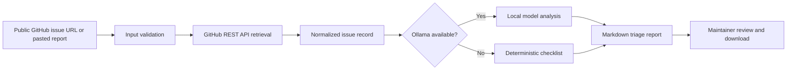

# MaintainerLens

[](https://github.com/amansharmas7/MaintainerLens/actions/workflows/python-checks.yml)
[](https://www.python.org/)
[](https://streamlit.io/)
[](LICENSE)

**Turn unclear GitHub issues into structured, evidence-aware triage reports.**

MaintainerLens is a human-in-the-loop assistant for open-source maintainers. It retrieves public GitHub issues, identifies commonly missing diagnostic details, and drafts a response for maintainer review. It can use a locally running Ollama model, with a deterministic fallback when model inference is unavailable.

> **Project status:** Working prototype. It does not post comments, change labels, modify repositories, or make final severity decisions. Review all generated content before using it.

## Why MaintainerLens

Issue reports often arrive without reproduction steps, environment details, logs, or a clear description of expected behaviour. MaintainerLens organises the information already supplied and turns gaps into concrete follow-up questions.

## Features

- **GitHub issue retrieval** — accepts canonical public issue URLs and retrieves issue metadata through the GitHub REST API.
- **Diagnostic completeness checks** — looks for reproduction steps, error messages, environment/version details, and expected-versus-actual behaviour.
- **Local AI analysis** — sends the issue to an Ollama-compatible model configured by the user.
- **Deterministic fallback** — creates a clearly labelled checklist when local inference is unavailable.
- **Maintainer-ready output** — produces a Markdown triage report, suggested next action, and draft response.
- **Human approval** — never writes back to GitHub or changes repository state.

## Architecture



Core logic is isolated in `maintainerlens/core.py`; `streamlit_app.py` handles the user interface. Unit tests cover URL validation, issue normalization, fallback reporting, and the Ollama request contract.

## Technology

- Python 3.11+
- Streamlit
- GitHub REST API
- Ollama-compatible local inference
- pytest and Ruff

## Requirements

- Python 3.11 or newer
- Internet access for public GitHub issue retrieval
- Ollama running locally for AI-assisted analysis
- A model installed in Ollama (the default model name is configurable)

The deterministic fallback works without Ollama.

## Run locally

### 1. Clone the repository

```bash
git clone https://github.com/amansharmas7/MaintainerLens.git
cd MaintainerLens
```

### 2. Create a virtual environment

**Windows PowerShell**

```powershell
python -m venv .venv
.\.venv\Scripts\Activate.ps1
```

**macOS / Linux**

```bash
python3 -m venv .venv
source .venv/bin/activate
```

### 3. Install dependencies

For normal use:

```bash
python -m pip install --upgrade pip
python -m pip install -r requirements.txt
```

For development and tests:

```bash
python -m pip install -r requirements-dev.txt
```

### 4. Start MaintainerLens

```bash
python -m streamlit run streamlit_app.py
```

Open the local URL printed by Streamlit (normally <http://localhost:8501>).

## Configure Ollama

The sidebar exposes the Ollama endpoint and model name. You can also set:

| Variable | Default | Description |
| --- | --- | --- |
| `OLLAMA_URL` | `http://127.0.0.1:11434` | Ollama-compatible API base URL |
| `OLLAMA_MODEL` | `gemma4:e2b` | Model tag available to the configured Ollama instance |

Check that Ollama is running and that the selected model is installed before choosing AI analysis. If the request fails, MaintainerLens shows the fallback report and explains that it is rule-based rather than model-generated.

## Use it

1. Paste a public GitHub issue URL or paste the issue description.
2. Choose the Ollama endpoint and model in the sidebar.
3. Select **Analyze issue**.
4. Review the evidence, missing-information checklist, priority suggestion, and draft reply.
5. Download the report as Markdown.

## Project structure

```text
.
├── maintainerlens/
│   ├── __init__.py
│   └── core.py
├── tests/
│   └── test_core.py
├── docs/
│   ├── maintainerlens-architecture.md
│   └── maintainerlens-demo.png
├── .github/
│   ├── ISSUE_TEMPLATE/
│   └── workflows/
├── streamlit_app.py
├── requirements.txt
├── requirements-dev.txt
└── pyproject.toml
```

## Development checks

Run the same quality checks used by GitHub Actions:

```bash
python -m compileall -q maintainerlens tests streamlit_app.py
ruff check maintainerlens tests
ruff format --check maintainerlens tests
pytest
```

The CI workflow runs these checks on pushes and pull requests to `main`.

## Responsible use and limitations

- Only public GitHub issue URLs are supported by the current issue fetcher.
- Unauthenticated GitHub API requests are subject to public rate limits.
- The fallback report is keyword-based and must not be treated as an AI diagnosis.
- Model output can be incomplete or incorrect; verify suggestions before acting on them.
- Priority suggestions are prompts for human review, not authoritative severity classifications.
- The Ollama endpoint is configurable; do not expose an unauthenticated MaintainerLens deployment to untrusted users without adding appropriate access controls and network restrictions.
- Do not paste passwords, access tokens, private issue contents, personal data, or other secrets.

## Contributing

Please read [CONTRIBUTING.md](CONTRIBUTING.md) before opening a pull request. Report vulnerabilities privately using the process in [SECURITY.md](SECURITY.md).

## License

MIT. See [LICENSE](LICENSE).
